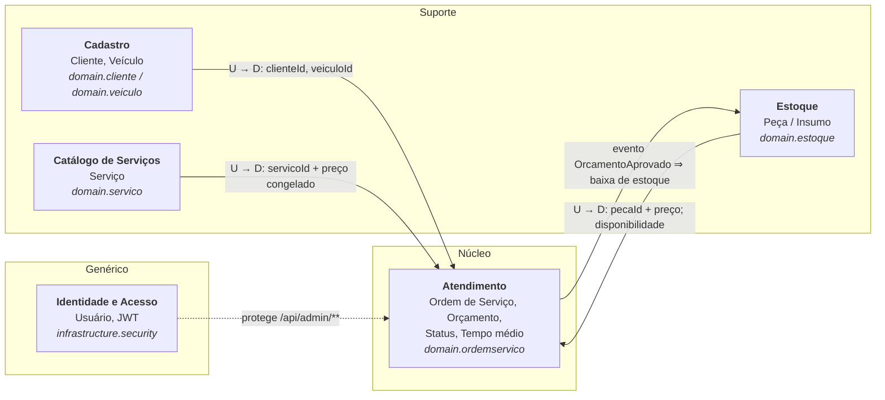
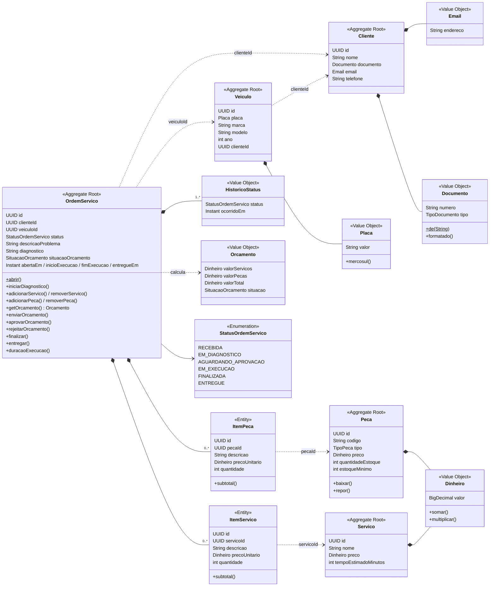
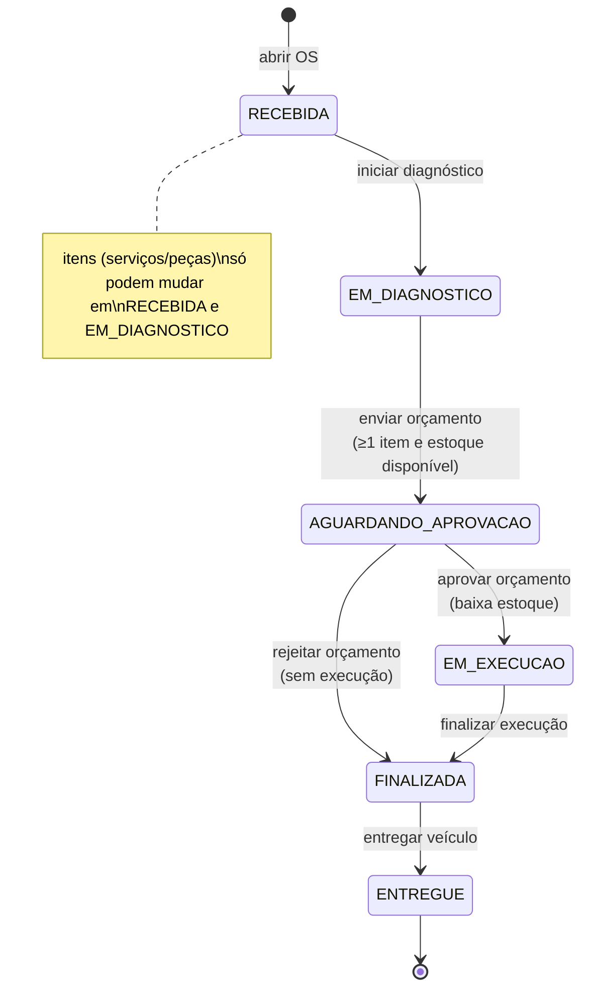
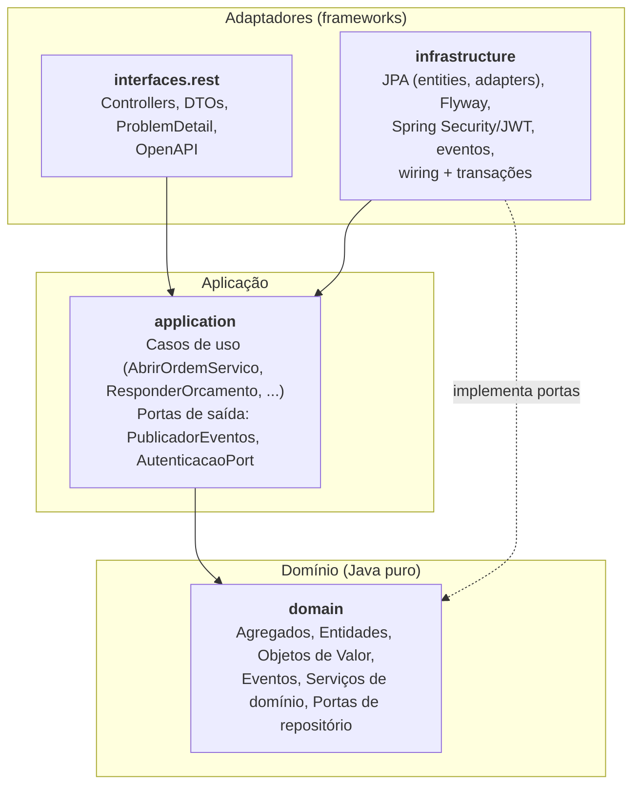
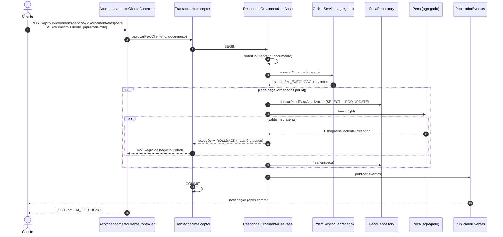
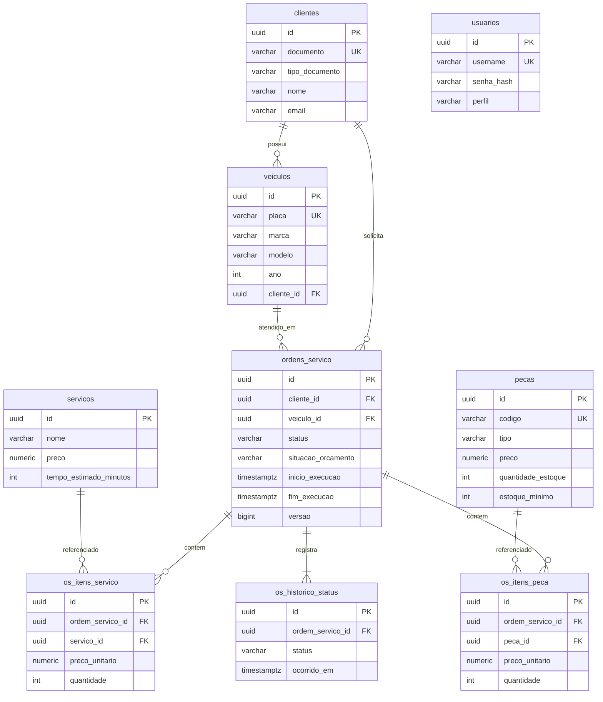

# Diagramas DDD — Oficina Mecânica

Os diagramas abaixo descrevem a solução **como implementada** no código deste repositório.
Versão em PDF: [diagramas.pdf](diagramas.pdf) · Event Storming: [event-storming.pdf](event-storming.pdf) · Glossário: [linguagem-ubiqua.md](linguagem-ubiqua.md)

## 1. Mapa de contextos (Bounded Contexts)

Por ser um MVP monolítico, os contextos são **módulos (pacotes) do mesmo monólito**, com fronteiras explícitas:
os agregados de um contexto referenciam os de outro **apenas por identificador**, nunca por objeto.

| Contexto | Tipo | Responsabilidade | Relação |
|---|---|---|---|
| Atendimento | Core | Ciclo de vida da OS, orçamento, aprovação, status, tempo médio | Downstream (consumidor) de Cadastro, Catálogo e Estoque — *Customer/Supplier* |
| Cadastro | Suporte | Clientes (CPF/CNPJ) e veículos (placa) | Upstream |
| Catálogo de Serviços | Suporte | Serviços com preço e tempo estimado | Upstream; o preço é copiado para a OS (*Published Language* via id + snapshot) |
| Estoque | Suporte | Saldo de peças/insumos, entradas, saídas, alerta de mínimo | Upstream na inclusão; reage à aprovação do orçamento |
| Identidade e Acesso | Genérico | Login e emissão/validação de JWT | Conformista (Spring Security) |

## 2. Agregados, entidades e objetos de valor

**Serviço de domínio:** `CalculadoraTempoMedioExecucao` (tempo médio geral e por serviço, a partir das OS executadas).
**Portas de repositório (domínio):** `ClienteRepository`, `VeiculoRepository`, `ServicoRepository`, `PecaRepository`, `OrdemServicoRepository`.

## 3. Ciclo de vida da Ordem de Serviço (máquina de estados)

## 4. Eventos de domínio

| Evento | Emitido por | Quando | Reação (política) |
|---|---|---|---|
| `OrdemServicoAberta` | `OrdemServico.abrir()` | OS criada | — |
| `StatusOrdemServicoAlterado` | toda transição de status | mudança de etapa | notificar o cliente (`NotificacoesListener`) |
| `OrcamentoEnviado` | `enviarOrcamento()` | orçamento disponível | notificar o cliente para aprovação |
| `OrcamentoAprovado` | `aprovarOrcamento()` | cliente autorizou | iniciar execução + baixar estoque (mesma transação) |
| `OrcamentoRejeitado` | `rejeitarOrcamento()` | cliente recusou | finalizar sem execução |
| `OrdemServicoFinalizada` | `finalizar()` | execução concluída | avisar que o veículo está pronto |
| `VeiculoEntregue` | `entregar()` | veículo devolvido | encerra a OS |
| `EstoqueAbaixoDoMinimo` | `Peca.baixar()` | saldo < mínimo | alerta de reposição |

Os eventos são acumulados no agregado (`AgregadoRaiz`), publicados pela aplicação através da porta
`PublicadorEventos` e tratados **após o commit** (`@TransactionalEventListener`).

## 5. Arquitetura: Clean Architecture em monólito

A regra de dependência (setas sempre para dentro) é verificada automaticamente pelo teste
`ArquiteturaTest` (ArchUnit): o domínio e a aplicação **não importam** Spring, JPA nem Jackson.

## 6. Sequência: aprovação do orçamento pelo cliente

## 7. Modelo de dados (PostgreSQL)

## 8. Relação documentação ↔ código

| Elemento DDD | Implementação |
|---|---|
| Agregado Ordem de Serviço | `src/main/java/br/com/oficina/domain/ordemservico/OrdemServico.java` |
| Regras de transição | `StatusOrdemServico.proximosPermitidos()` + `OrdemServico.alterarStatus()` |
| Objetos de valor | `Documento`, `Placa`, `Dinheiro`, `Email`, `Orcamento`, `HistoricoStatus` |
| Eventos de domínio | `domain/ordemservico/evento/*`, `domain/estoque/EstoqueAbaixoDoMinimo` |
| Políticas | `ResponderOrcamentoUseCase` (baixa de estoque), `NotificacoesListener` (notificações) |
| Comandos | métodos públicos dos casos de uso em `application/**` ↔ endpoints em `interfaces/rest/**` |
| Repositórios (portas/adaptadores) | `domain/**/…Repository` ↔ `infrastructure/persistence/adapter/*` |
| Serviço de domínio | `CalculadoraTempoMedioExecucao` |
| Testes das regras | `src/test/java/br/com/oficina/domain/**` (100% de linhas cobertas) |
